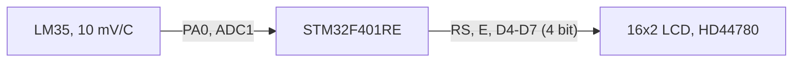

# Proteus'ta STM32 simülasyonu: LM35 ile sıcaklık ölçüp LCD'ye yazma

Kart olmadan STM32 denemek isteyenler için bir örnek. Kod STM32CubeIDE'de yazılıyor, çıkan `.hex` dosyası Proteus'taki STM32F401RE modeline yükleniyor. LM35'ten okunan sıcaklık 16x2 LCD'de gösteriliyor.

Aşağıda hem devrenin Proteus'ta nasıl kurulacağını hem de derlenen dosyanın işlemciye nasıl yükleneceğini anlattım.

## Blok diyagram



## Bağlantılar

| İşlemci pini | Bağlandığı yer |
|---|---|
| PA0 | LM35 VOUT |
| PA6 | LCD RS |
| PA7 | LCD E |
| PA8 | LCD D4 |
| PA9 | LCD D5 |
| PA10 | LCD D6 |
| PA14 | LCD D7 |

LCD'nin RW ucu toprağa, VSS toprağa, VDD beslemeye gider. LM35'in +VS ucu beslemeye, GND ucu toprağa.

## Proteus'ta devreyi kurma

1. Yeni proje aç, şematik sayfasında `P` tuşuyla parça penceresini aç.
2. Şu üç parçayı ekle: `STM32F401RE`, `LM016L` (16x2 LCD), `LM35`.
3. Yukarıdaki tabloya göre bağla. Besleme ve toprak için soldaki terminal menüsünden `POWER` ve `GROUND` kullan.
4. LM35'in üzerindeki oklarla simülasyon sırasında sıcaklığı değiştirebilirsin.

Proteus kütüphanesinde STM32F407 modeli yok, o yüzden proje F401RE ile kuruldu. Sürümüne göre F103 gibi başka modeller de bulunur, onlarda `.ioc` dosyasını o işlemciye göre yeniden oluşturman gerekir.

## Kodu derleyip Proteus'a yükleme

1. STM32CubeIDE'de `File > Import > Existing Projects into Workspace` ile bu klasörü aç.
2. Projeyi derle. `Debug` klasöründe `stm32-proteus-lm35-lcd.hex` oluşur.
3. `.hex` çıkmıyorsa: proje üzerinde sağ tık, `Properties > C/C++ Build > Settings > MCU Post build outputs` altında `Convert to Intel Hex file` kutusunu işaretle.
4. Proteus'ta işlemciye çift tıkla. `Program File` satırındaki klasör simgesinden bu `.hex` dosyasını seç.
5. Sol alttaki oynat düğmesiyle simülasyonu başlat.

Kodu her değiştirdiğinde yeniden derlemen yeterli. Proteus aynı dosyayı gösterdiği için simülasyonu durdurup başlatınca yeni kod çalışır.

## Hesap

```
gerilim  = ADC_VREF * adc / 4095
sıcaklık = gerilim * 100        (LM35 derece başına 10 mV verir)
```

Proteus'ta işlemcinin analog referansı besleme rayına bağlı ve bu ray varsayılan olarak 5 V. Bu yüzden `main.c` içinde `ADC_VREF` 5.0 olarak duruyor. Aynı kodu gerçek karta yükleyeceksen 3.3 yap.

## Gerçek kartta dikkat

- PA14 gerçek işlemcide SWCLK pini. Simülasyonda sorun olmuyor ama kartta LCD D7'yi başka bir pine taşı, yoksa programlayıcı bağlanamaz.
- `HAL_Delay` süreleri simülasyonda tutmuyorsa işlemcinin özelliklerinde saat frekansını 16 MHz yap. Kod dahili 16 MHz osilatöre göre ayarlı.

## LCD sürücüsü

`Core/Src/lcd.c` içinde HD44780 için 4 bit modda çalışan kısa bir sürücü var: `LCD_Init`, `LCD_Clear`, `LCD_SetCursor`, `LCD_SendString`. Pinler `lcd.h` içinde tanımlı, başka pine taşımak için sadece o dosyayı değiştir.

## Durum

Ekran biçimini düzenledikten sonra simülasyonda yeniden çalıştırmadım.

## Lisans

MIT. `Drivers` klasöründeki STM32 HAL ve CMSIS dosyaları kendi lisanslarıyla gelir.

## Yazar

Gömülü Sistem Mühendisi M. Eyüb Can, [TECH-OHM](https://tech-ohm.com)
