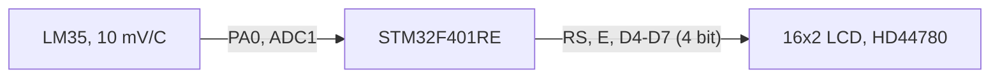

# STM32 in Proteus: LM35 thermometer with a 16x2 LCD

STM32F401 · simulation · CubeIDE to Proteus workflow

   [](https://tech-ohm.com)

**English** | [Türkçe](README.tr.md) · An open-source project by [TECH-OHM](https://tech-ohm.com)

An example for trying out STM32 without a board. The code is written in STM32CubeIDE and the resulting `.hex` file is loaded into the STM32F401RE model in Proteus. The temperature read from an LM35 is shown on a 16x2 LCD.

Below I explain how to draw the circuit in Proteus and how to load the compiled file into the simulated MCU.

## Block diagram



## Connections

| MCU pin | Connects to |
|---|---|
| PA0 | LM35 VOUT |
| PA6 | LCD RS |
| PA7 | LCD E |
| PA8 | LCD D4 |
| PA9 | LCD D5 |
| PA10 | LCD D6 |
| PA14 | LCD D7 |

LCD RW and VSS go to ground, VDD to supply. LM35 +VS goes to supply and GND to ground.

## Drawing the circuit in Proteus

1. Create a new project and press `P` on the schematic sheet to open the part picker.
2. Add three parts: `STM32F401RE`, `LM016L` (16x2 LCD) and `LM35`.
3. Wire them as in the table above. Use `POWER` and `GROUND` from the terminals menu on the left.
4. During simulation, the arrows on the LM35 change the temperature.

The Proteus library has no STM32F407 model, which is why this project uses the F401RE. Depending on your version other models such as the F103 exist. For those you need to recreate the `.ioc` file for that MCU.

## Building and loading into Proteus

1. In STM32CubeIDE use `File > Import > Existing Projects into Workspace` and open this folder.
2. Build the project. `stm32-proteus-lm35-lcd.hex` appears in the `Debug` folder.
3. If no `.hex` is produced: right-click the project, go to `Properties > C/C++ Build > Settings > MCU Post build outputs` and tick `Convert to Intel Hex file`.
4. In Proteus double-click the MCU. Use the folder icon on the `Program File` line to select the `.hex` file.
5. Start the simulation with the play button at the bottom left.

After that, rebuilding is enough whenever you change the code. Proteus points at the same file, so stopping and restarting the simulation runs the new code.

## The math

```
voltage     = ADC_VREF * adc / 4095
temperature = voltage * 100        (LM35 gives 10 mV per degree)
```

In Proteus the MCU's analog reference is tied to the supply rail, which is 5 V by default. That is why `ADC_VREF` in `main.c` is 5.0. Set it to 3.3 if you put the same code on a real board.

## On real hardware

- PA14 is the SWCLK pin on a real MCU. It causes no trouble in simulation, but on a board move LCD D7 to another pin or the programmer cannot connect.
- If `HAL_Delay` timings look wrong in simulation, set the clock frequency in the MCU's properties to 16 MHz. The code is set up for the internal 16 MHz oscillator.

## LCD driver

`Core/Src/lcd.c` is a short HD44780 driver in 4-bit mode: `LCD_Init`, `LCD_Clear`, `LCD_SetCursor`, `LCD_SendString`. The pins are defined in `lcd.h`, so moving to other pins means editing only that file.

## Status

I changed the display formatting and have not re-run the simulation since.

## License

MIT. The STM32 HAL and CMSIS files under `Drivers` keep their own licenses.

## Author

M. Eyüb Can, embedded systems engineer and founder of [TECH-OHM](https://tech-ohm.com)

## About TECH-OHM

[TECH-OHM](https://tech-ohm.com) designs electronic boards and embedded software, from the first schematic to series production. We also run a 12-month embedded systems training program and consult for engineering teams.

Web: [tech-ohm.com](https://tech-ohm.com) · Email: info@tech-ohm.com
